**Universidad Nacional de Colombia – Sede Medellín** · Introducción a la Inteligencia Artificial (3010476) · Profesor Jaime Alberto Guzmán Luna

| Dato | Valor |
|---|---|
| Integrantes | [Nombre 1], [Nombre 2], [Nombre 3], José Luis Sánchez Álvarez |
| Grupo y equipo | Grupo [XX], equipo [YY] |
| Cédula usada | 1033178679 |
| Registros del subconjunto | 5000 + 9 × 150 = 6350 (último dígito distinto de cero: 9) |
| Semilla (`random_state`) | 79 (dos últimos dígitos distintos de cero) |
| Video pitch | [enlace de YouTube] |
| Dataset original | [Resultados únicos Saber 11 – ICFES](https://drive.google.com/file/d/1gt26zB3NPERbmZ1zwE4fsRLixuNNF6gq/view?usp=sharing) |
| Código | `practica-2.ipynb`. Módulo supervisado: secciones 0 a 7. Módulo no supervisado: sección 8 |

Cada sección de este documento indica entre paréntesis la sección del notebook donde está el código y el detalle completo.

## Resumen

Predecimos el nivel de desempeño en matemáticas (Nivel 1 a 4) de los estudiantes que presentaron el Saber 11 de 2022, a partir de sus puntajes en las otras áreas y de información de su familia y su colegio. Construimos 8 versiones del entrenamiento combinando escalado, outliers y balanceo, y en cada una entrenamos un árbol de decisión, KNN, una SVM y una red neuronal. El balanceo fue lo que más mejoró los modelos, el escalado solo importó en KNN y en la red, y los outliers casi no cambiaron nada. El mejor resultado fue el de la SVM en el caso 2 (F1 macro de 0.605).

Después quitamos la etiqueta y agrupamos los mismos datos con K-Means y DBSCAN. K-Means encontró dos grupos, desempeño bajo y desempeño alto, que separan bien el Nivel 1 del Nivel 4 pero no los niveles intermedios. DBSCAN, con la regla del enunciado, dejó todo en un solo cluster. Ambos resultados indican que el desempeño se comporta como un continuo, y por eso todos los clasificadores se equivocan sobre todo entre niveles vecinos.

# Módulo 1 – Aprendizaje supervisado

## 1. Dataset *(notebook: sección 1)*

### 1.1 Dominio y justificación

Elegimos el dominio de la educación. El desempeño en matemáticas del Saber 11 pesa en el acceso a la educación superior, y predecirlo a partir del contexto del estudiante permite identificar a tiempo a quienes tienen riesgo de quedar en los niveles bajos. La variable objetivo es `DESEMP_MATEMATICAS`, con los rangos oficiales del ICFES: Nivel 1 (0–35), Nivel 2 (36–50), Nivel 3 (51–70) y Nivel 4 (71–100).

### 1.2 Fuente y generación del subconjunto

Partimos del archivo *Resultados únicos Saber 11* del ICFES (datos abiertos): 1 085 937 registros y 51 columnas de las aplicaciones 2022-1 y 2022-2. Para obtener el subconjunto:

1. Descartamos los registros sin puntaje de matemáticas válido y construimos la etiqueta con los rangos del ICFES.
2. Eliminamos las variables con fuga de información (`PUNT_MATEMATICAS`, de donde sale la etiqueta; `PUNT_GLOBAL`, que la incluye; y los percentiles) y los identificadores.
3. Extrajimos 6350 registros con muestreo estratificado por la etiqueta y `random_state = 79`. Estratificamos para que el Nivel 4 (4.9 %) no quedara sub- o sobrerrepresentado por azar.

El notebook puede regenerar el subconjunto desde el original (`GENERAR_SUBCONJUNTO = True`). Verifica la huella SHA-256 del archivo de partida, porque el muestreo depende del orden de las filas. El CSV va en el ZIP y tiene una copia en Drive, para que el notebook corra en Colab sin pasos manuales.

### 1.3 Verificación de requisitos y variables

| Requisito | Subconjunto |
|---|---|
| ≥ 5000 registros | 6350 |
| ≥ 4 clases | Nivel 1: 11.9 % · Nivel 2: 36.6 % · Nivel 3: 46.6 % · Nivel 4: 4.9 % |
| Numéricas y categóricas | 23 predictores tras la limpieza: 5 numéricos, 5 ordinales y 13 nominales |

| Tipo | Variables |
|---|---|
| Numéricas (5) | Puntajes de lectura crítica, ciencias naturales, sociales y ciudadanas e inglés (0–100); `EDAD` (calculada desde la fecha de nacimiento) |
| Ordinales (5) | Estrato, educación de la madre, educación del padre, cuartos del hogar, personas del hogar |
| Nominales (13) | Área (urbano/rural), bilingüe, carácter, departamento, género del colegio, jornada, naturaleza (oficial o no), sede principal, género del estudiante, y si el hogar tiene automóvil, computador, internet y lavadora |

Conservamos los puntajes de las otras áreas como predictores porque son pruebas independientes del mismo examen: no se derivan del puntaje de matemáticas, así que no hay fuga. Además, son prácticamente las únicas variables numéricas disponibles para el tratamiento de outliers.

## 2. Limpieza y análisis exploratorio *(notebook: secciones 2 y 3)*

### 2.1 Limpieza de variables

Además de lo eliminado al generar el subconjunto, quitamos 14 columnas. Cada eliminación está respaldada con un dato:

| Columna | Evidencia | Decisión |
|---|---|---|
| `ESTU_ESTADOINVESTIGACION`, `ESTU_ESTUDIANTE` | Un solo valor en el 100 % de las filas | Eliminar (constantes) |
| `COLE_CALENDARIO`, `ESTU_NACIONALIDAD`, `ESTU_PRIVADO_LIBERTAD` | Un valor ocupa el 98.3 %, 98.7 % y 99.9 % (umbral: 98 %) | Eliminar (casi constantes) |
| `PERIODO` | 98.3 % es 2022-2; su relación con el nivel viene del calendario B, ya reflejado en naturaleza, bilingüe y estrato | Eliminar (administrativa) |
| `ESTU_FECHANACIMIENTO` | Texto con ~1700 valores distintos | Reemplazar por `EDAD` |
| Municipios del colegio, de residencia y de presentación | 453–774 categorías, muchas con menos de 5 registros | Eliminar (se usa el departamento) |
| Departamentos de residencia y de presentación | Coinciden con el del colegio en el 98.9 % y 97.9 % | Eliminar (redundantes) |
| `ESTU_PAIS_RESIDE` | Igual a la nacionalidad en el 100 % | Eliminar (duplicada) |
| `DESEMP_INGLES` | Rangos de `PUNT_INGLES` (ρ de Spearman ≈ 0.94) | Eliminar (redundante) |

`COLE_GENERO` se conserva aunque el 97.4 % sea mixto, porque en los colegios femeninos y masculinos el Nivel 4 llega al 12–14 %, frente al 4.7 % en los mixtos. También calculamos `EDAD` al 1 de septiembre de 2022, pasamos a nulo las edades fuera de 13–80 años (fechas imposibles) y tratamos "No sabe" y "No aplica" en la educación de los padres como faltantes. Sin esta limpieza, el One-Hot habría generado miles de columnas; con ella el dataset queda en **65 columnas**.

### 2.2 Análisis exploratorio

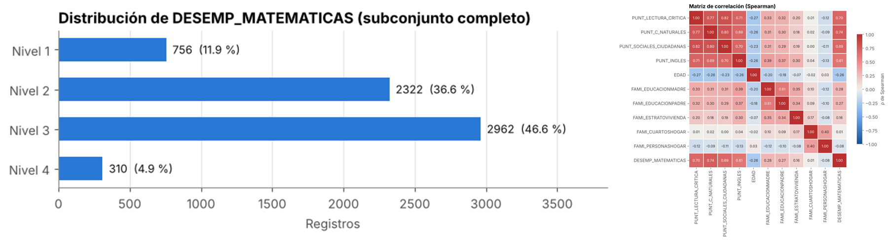

- **Desbalance natural.** Nivel 3 y Nivel 2 suman el 83 %, y Nivel 4 tiene el 4.9 %. Un clasificador que siempre prediga Nivel 3 tendría un accuracy de ~0.47, por eso priorizamos el **F1 macro** y el recall por clase.
- **Predictores principales.** Los puntajes de las otras áreas tienen ρ entre 0.61 y 0.74 con el objetivo. Les siguen la educación de los padres (ρ ≈ 0.27) y el estrato (ρ ≈ 0.16). La edad tiene correlación negativa (ρ ≈ −0.26).
- **Los puntajes están correlacionados entre sí** (ρ entre 0.69 y 0.82), lo que reparte la importancia entre ellos en el árbol.
- **Hay atípicos reales:** edades de hasta 67 años (jornadas nocturna y sabatina) y puntajes de 0 y de 100.

Usamos Spearman en lugar de Pearson porque 5 de las variables y el objetivo son ordinales.

### 2.3 Valores nulos

El 34 % de las filas tiene algún nulo, y ninguna variable pasa del ~18 %. Los nulos no son aleatorios: las filas con nulos tienen más Nivel 1 (14.8 % frente a 10.4 %) y más colegios rurales (21.9 % frente a 14.4 %). Eliminarlas sesgaría la muestra contra los estudiantes rurales y de bajo desempeño, así que **imputamos**: moda en las categóricas y mediana en `PUNT_INGLES` y `EDAD` (robusta a la cola de edades altas), calculadas solo con el entrenamiento.

## 3. Partición y preprocesamiento: los 8 casos de la Figura 1 *(notebook: sección 4)*

Todo ajuste que aprende de los datos se hace **solo con el entrenamiento**. Validación y prueba solo se transforman, conservan la distribución real y son las mismas en los 8 casos.

| Paso | Qué se hace | Se ajusta con |
|---|---|---|
| 1. Partición | 70 / 15 / 15 estratificada (4445 / 952 / 953), `random_state = 79` | Una sola vez |
| 2. Imputación | Mediana (numéricas) y moda (categóricas) | Entrenamiento base |
| 3. Outliers NO | Se eliminan las filas detectadas con IQR | Límites del entrenamiento base |
| 4. CC ordinal | Cada ordinal se reemplaza por su posición en el orden del dominio | Orden fijo |
| 5. Balanceo | NO: submuestreo a 70/10/10/10 · SI: SMOTENC | Entrenamiento del caso |
| 6. Outliers SI | Se conservan los reales y se inyectan sintéticos hasta el 5 % | Límites del entrenamiento base |
| 7. CC One-Hot | 13 variables nominales | Entrenamiento base |
| 8. ED | StandardScaler sobre numéricas y ordinales (casos 5–8) | Entrenamiento del caso |

**Orden de los pasos.** Los outliers se eliminan antes de balancear, para que SMOTE no genere registros a partir de atípicos. Se balancea antes de escalar, para que los casos *k* y *k+4* tengan los mismos registros y difieran solo en el escalado. Los outliers se inyectan después de balancear, para que sean exactamente el 5 % del entrenamiento final.

- **Conversión de categóricas (CC).** Codificación ordinal para las 5 variables con orden natural (por ejemplo, de *Ninguno* a *Postgrado*). *Sin estrato* va en la posición más baja porque tiene el peor desempeño (31 % en Nivel 1, frente a 13 % en estrato 1). One-Hot para las 13 nominales, porque un número les impondría un orden que no tienen; `drop="if_binary"` deja una columna por variable binaria. El One-Hot se ajusta una sola vez para que los 8 casos tengan las mismas 65 columnas.
- **Escalado (ED).** StandardScaler sobre numéricas y ordinales; las dummies quedan en 0/1. Lo preferimos a MinMaxScaler porque se distorsiona menos con outliers: en MinMax un solo valor extremo fija el máximo, y los casos 7 y 8 tienen outliers.
- **Outliers.** Detección con IQR (factor 1.5) sobre las 5 numéricas; no usamos Z-score porque `EDAD` es muy asimétrica. *Sin outliers*: eliminamos las filas detectadas (137, ~3 % del entrenamiento), sin winsorizar, porque eso alteraría valores reales. *Con outliers*: conservamos los reales e inyectamos sintéticos hasta el 5 %, cambiando 1 o 2 variables numéricas de filas normales (semilla 79) por un valor fuera de los límites IQR pero posible (0–100 en puntajes, 13–80 en edad). En el caso 4 había 368 atípicos y se inyectaron 47.
- **Balanceo.** *Desbalanceado*: submuestreo a 70/10/10/10 con Nivel 3 como mayoritaria; solo usa registros reales y Nivel 4 (205 registros) fija el tamaño. *Balanceado*: SMOTENC hasta igualar la mayoritaria. Lo elegimos frente a duplicar registros (favorece el sobreajuste), al submuestreo (descartaría ~80 % de los datos) y al SMOTE clásico (interpolaría las dummies y crearía categorías inexistentes).

| Caso | ED | Outliers | Balanceo | Registros de entrenamiento | Distribución (N1/N2/N3/N4) |
|---|---|---|---|---|---|
| 1 | NO | NO | NO | 2050 | 10/10/70/10 % |
| 2 | NO | NO | SI | 8208 | 25 % cada uno |
| 3 | NO | SI | NO | 2170 | 10/10/70/10 % |
| 4 | NO | SI | SI | 8296 | 25 % cada uno |
| 5 | SI | NO | NO | 2050 | 10/10/70/10 % |
| 6 | SI | NO | SI | 8208 | 25 % cada uno |
| 7 | SI | SI | NO | 2170 | 10/10/70/10 % |
| 8 | SI | SI | SI | 8296 | 25 % cada uno |

Los casos desbalanceados quedan con ~2100 registros (~32 por columna). Lo consideramos suficiente: la prueba es la misma para todos y el menor desempeño esperado es justamente el efecto que el enunciado pide analizar.

**Contrato común.** Todas las métricas de prueba las calcula una sola función (`registrar_resultado`, sección 4.10), con promedio **macro** para que el Nivel 4 (4.9 %) pese igual que el Nivel 3 (46.6 %). Los "3 datos de prueba" son 3 registros fijos de prueba (uno de Nivel 1, uno de Nivel 3 y uno de Nivel 4), los mismos para todas las técnicas.

## 4. Entrenamiento de los modelos supervisados *(notebook: secciones 5 y 6)*

En las cuatro técnicas los hiperparámetros se eligen sin mirar la prueba, seguimos las herramientas de los notebooks de clase y no usamos `class_weight`, para que la Figura 1 aísle el efecto de la versión del dataset.

### 4.1 Árboles de decisión *(sección 5.1)*

Para cada caso entrenamos árboles con `max_depth` de 1 a 15 con Gini y con entropía, y elegimos la profundidad con mayor accuracy de validación (en empate, la menor). Usamos `max_depth` y no `ccp_alpha` porque la profundidad se lee directamente en el gráfico.

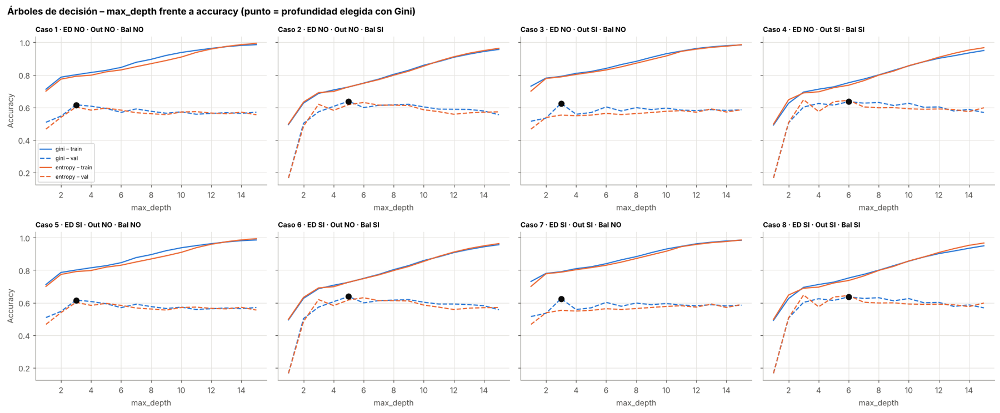{width=90%}

- **Subajuste:** con `max_depth` = 1 el accuracy de validación es 0.508 (caso 1) y 0.165 (caso 2). **Sobreajuste:** con `max_depth` = 15 el entrenamiento llega a 0.950–0.985 mientras validación se estanca en 0.555–0.585.
- **Profundidades elegidas:** 3 en los casos desbalanceados, 5 en los casos 2 y 6 y 6 en los casos 4 y 8.
- **Gini frente a entropía:** las curvas casi se superponen; Gini gana en 6 de 8 casos. En los casos 3 y 7 la entropía elige profundidad 13 y sobreajusta (0.969 en entrenamiento). Registramos el árbol con Gini.
- **Los casos *k* y *k+4* dan el mismo árbol:** los cortes son de una variable a la vez y escalar no cambia el orden de los valores.

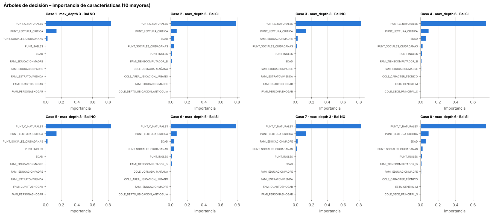{width=90%}

`PUNT_C_NATURALES` concentra entre 0.749 y 0.840 de la importancia y `PUNT_LECTURA_CRITICA` es la segunda (0.074–0.139). Los otros puntajes casi no aparecen porque están correlacionados con ciencias. Con balanceo entran `EDAD` (0.043–0.062) y `FAMI_TIENECOMPUTADOR_Si`.

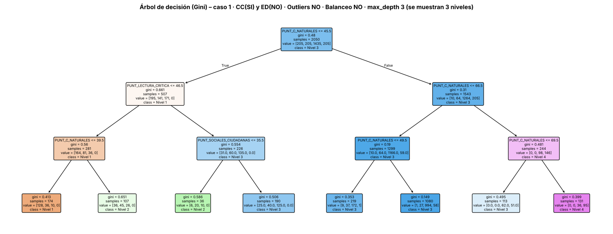

**Interpretación (caso 1).** La raíz es ciencias ≤ 45.5. La regla de riesgo más clara es ciencias ≤ 39.5 y lectura ≤ 46.5: en esa hoja, 128 de 174 estudiantes son de Nivel 1. El Nivel 4 solo se predice con ciencias > 69.5, muy cerca del corte oficial de Nivel 4 en matemáticas (71). El Nivel 2 aparece en hojas impuras, lo que concuerda con su recall de 0.235. Con balanceo (caso 4), la edad y tener computador aparecen en las ramas de puntaje alto, pero el nivel lo deciden los puntajes.

### 4.2 KNN *(sección 5.2)*

Elegimos *k* (impares de 1 a 51) con el accuracy promedio de una validación cruzada estratificada de 5 folds sobre el entrenamiento, con distancia euclidiana y voto uniforme.

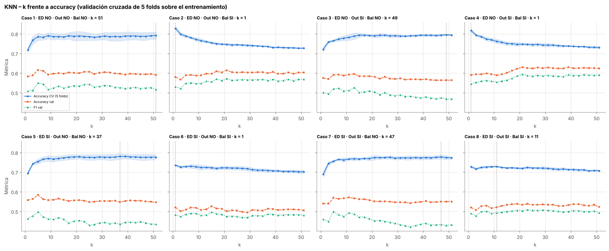{width=90%}

- **Desbalanceados (k = 37–51):** la curva queda casi plana desde k ≈ 9 (0.77–0.79). Ese accuracy está inflado porque los folds tienen 70 % de Nivel 3; en validación real baja a 0.548–0.591.
- **Casos 2, 4 y 6 (k = 1):** la validación cruzada da 0.817–0.828 porque un registro sintético de SMOTENC suele tener su "registro de origen" en el mismo fold. En validación real, k = 1 baja a 0.521–0.591. **Caso 8:** k = 11.
- Dejamos el *k* del criterio del enunciado y lo reportamos como ejemplo de que el accuracy engaña.

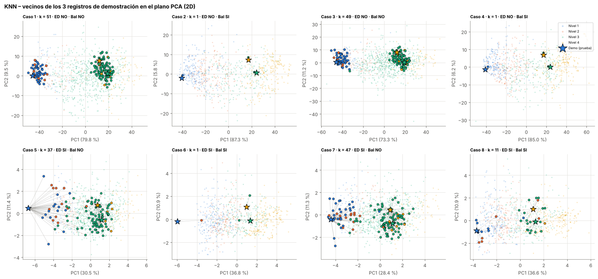{width=85%}

Los vecinos los calcula el modelo en las 65 columnas; PCA solo se usa para dibujar. Sin escalar, PC1 explica el 73–87 % de la varianza (los puntajes) y los vecinos aparecen agrupados alrededor de cada estrella. Con escalado, PC1 explica el 28–37 % y los vecinos se ven dispersos.

### 4.3 SVM *(sección 6.1)*

Evaluamos 12 configuraciones por caso con el F1 macro de validación: lineal con C ∈ {0.01, 0.1, 1} y RBF con C ∈ {0.1, 1, 10} × gamma ∈ {scale, 0.01, 0.1}. No usamos `GridSearchCV` porque, con SMOTENC, la validación cruzada resulta optimista.

- **Kernel:** el lineal gana en 7 de 8 casos (en el caso 2 el RBF gana por 0.007). La frontera entre niveles es casi lineal porque los puntajes se mueven juntos y el objetivo es ordinal.
- **C:** casi no cambia el resultado del lineal. En el RBF, un C alto sobreajusta: en el caso 8, con C = 10, entrenamiento 0.923 y validación 0.648.
- **gamma:** es lo más sensible a la escala. Con gamma = 0.1 el F1 de validación cae a 0.31–0.42 en el caso 4 (sin escalar), frente a 0.58–0.60 en el caso 8.

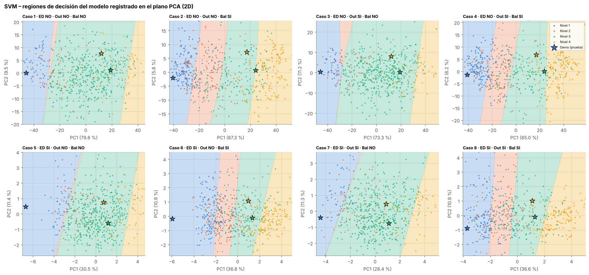{width=85%}

Para las regiones llevamos una malla del plano PCA a las 65 columnas con `inverse_transform` y la clasificamos con el modelo registrado. En los 8 casos salen franjas ordenadas de Nivel 1 a Nivel 4 a lo largo de PC1. Sin balanceo, la franja de Nivel 2 casi desaparece, lo que concuerda con su recall de 0.12–0.14.

### 4.4 Redes neuronales *(sección 6.2)*

Configuramos la red en el caso 8 cambiando un aspecto a la vez y usamos la misma red en los 8 casos. Un cambio solo se acepta si mejora el F1 de validación en al menos 0.01.

| Etapa | Variantes (F1 de validación) | Elegida |
|---|---|---|
| Activación | ReLU 0.5975 · tanh 0.6006 · sigmoid 0.5895 | ReLU (tanh mejora solo 0.003) |
| Optimizador | Adam lr 0.001 · Adam lr 0.01 · SGD lr 0.1 (0.4816) | Adam lr 0.001 (con lr 0.01 sobreajusta desde la época 3) |
| Regularización | Ninguna 0.5975 · Dropout 0.3: 0.6207 · L2 0.01: 0.6035 · ambas 0.6101 | Dropout 0.3 |
| Arquitectura | [32] 0.6083 · [64, 32] 0.6207 · [128, 64] 0.6061 | [64, 32] |

**Arquitectura final:** `Input(65) → Dense(64, ReLU) → Dropout(0.3) → Dense(32, ReLU) → Dropout(0.3) → Dense(4, softmax)`, Adam (lr = 0.001), pérdida `sparse_categorical_crossentropy`, lotes de 32 y hasta 150 épocas. **Callback:** EarlyStopping sobre la pérdida de validación, con paciencia 10 y restaurando los mejores pesos. Sin regularización, la pérdida de validación sube desde la época 5; con Dropout la mejor época pasa a la 11 y la brecha baja de 0.246 a 0.174.

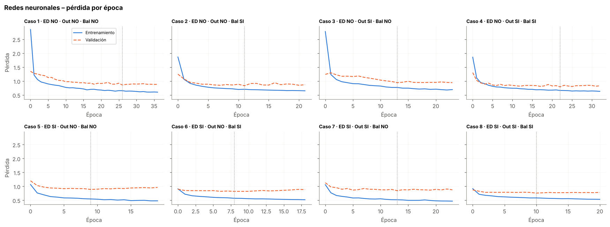{width=90%}

EarlyStopping detiene el entrenamiento entre las épocas 19 y 37. En los casos 1 y 3 (sin escalar y desbalanceados) la red no aprende Nivel 2 ni Nivel 4 (F1 de prueba 0.31), ni siquiera con paciencia 30. En los casos 2 y 4, también sin escalar pero balanceados, sí aprende las cuatro clases.

### 4.5 Evaluación de los 3 datos de prueba

Los registros de Nivel 1 y Nivel 3 se clasifican bien en casi todos los casos y técnicas. El de Nivel 4 se predice como Nivel 3 en las cuatro técnicas y los 8 casos. El balanceo sube su probabilidad de Nivel 4 (en la SVM, de 0.054–0.076 a 0.116–0.236), pero no lo suficiente para cambiar la predicción.

## 5. Evaluación de los modelos supervisados *(notebook: sección 7, pendiente)*

### 5.1 Figura 1 (prueba, promedio macro)

| # | Norm. | Out. | Bal. | Árbol Acc | Árbol Prec | Árbol Rec | Árbol F1 | KNN Acc | KNN Prec | KNN Rec | KNN F1 | SVM Acc | SVM Prec | SVM Rec | SVM F1 | Red Acc | Red Prec | Red Rec | Red F1 |
|---|---|---|---|---|---|---|---|---|---|---|---|---|---|---|---|---|---|---|---|
| 1 | ED NO | NO | NO | 0.606 | 0.606 | 0.542 | 0.537 | 0.596 | 0.658 | 0.569 | 0.525 | 0.590 | 0.584 | 0.579 | 0.519 | 0.537 | 0.241 | 0.443 | 0.309 |
| 2 | ED NO | NO | SI | 0.621 | 0.555 | 0.626 | 0.574 | 0.578 | 0.504 | 0.564 | 0.525 | 0.643 | 0.574 | 0.701 | **0.605** | 0.610 | 0.539 | 0.656 | 0.568 |
| 3 | ED NO | SI | NO | 0.617 | 0.618 | 0.525 | 0.531 | 0.570 | 0.638 | 0.560 | 0.483 | 0.589 | 0.601 | 0.564 | 0.516 | 0.528 | 0.265 | 0.384 | 0.307 |
| 4 | ED NO | SI | SI | 0.630 | 0.558 | 0.657 | 0.586 | 0.577 | 0.502 | 0.553 | 0.521 | 0.645 | 0.567 | 0.665 | 0.595 | 0.638 | 0.560 | 0.639 | 0.585 |
| 5 | ED SI | NO | NO | 0.606 | 0.606 | 0.542 | 0.537 | 0.564 | 0.625 | 0.475 | 0.438 | 0.588 | 0.582 | 0.572 | 0.515 | 0.562 | 0.565 | 0.556 | 0.467 |
| 6 | ED SI | NO | SI | 0.621 | 0.555 | 0.626 | 0.574 | 0.495 | 0.426 | 0.495 | 0.439 | 0.637 | 0.557 | 0.660 | 0.585 | 0.640 | 0.559 | 0.643 | 0.584 |
| 7 | ED SI | SI | NO | 0.617 | 0.618 | 0.525 | 0.531 | 0.550 | 0.628 | 0.466 | 0.429 | 0.587 | 0.601 | 0.562 | 0.514 | 0.607 | 0.613 | 0.582 | 0.540 |
| 8 | ED SI | SI | SI | 0.630 | 0.558 | 0.657 | 0.586 | 0.517 | 0.473 | 0.606 | 0.489 | 0.644 | 0.566 | 0.665 | 0.594 | 0.642 | 0.563 | 0.651 | 0.587 |

En todos los casos la normalización incluye CC(SI). Valores con 4 decimales en el notebook.

### 5.2 Gráficas de F1

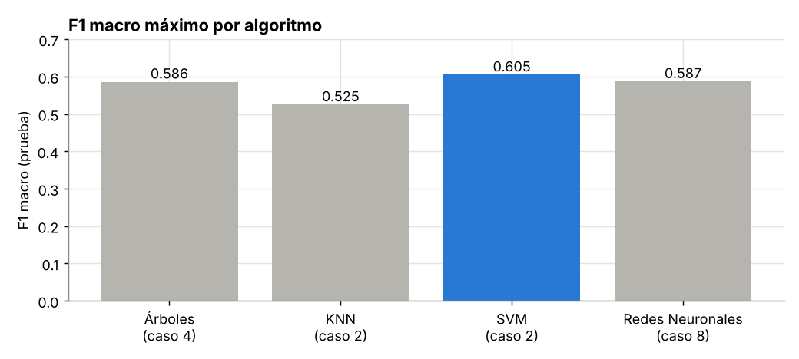{width=60%}

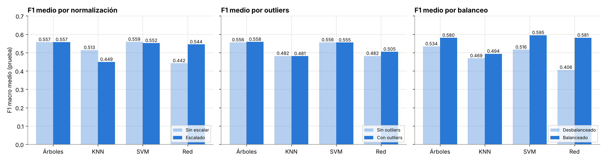

### 5.3 Análisis

- **El balanceo es el factor dominante.** Sin balanceo, el recall de Nivel 2 queda entre 0 y 0.27, y la red de los casos 1 y 3 no asigna ningún registro a Nivel 2 ni a Nivel 4. Con SMOTENC sube a 0.45–0.60, y el F1 medio mejora en las cuatro técnicas: árbol de 0.534 a 0.580, KNN de 0.469 a 0.494, SVM de 0.516 a 0.595 y red de 0.406 a 0.581.
- **Por qué el accuracy engaña.** En los casos desbalanceados, KNN tiene un accuracy de 0.55–0.60 pero detecta solo entre el 3 % y el 12 % del Nivel 2. El accuracy se sostiene porque acierta más del 90 % del Nivel 3, que es casi la mitad de la prueba.
- **Sensibilidad a la escala.** Árbol: no cambia (0.557 en ambos). KNN: empeora (0.514 a 0.449), porque sin escalar la distancia la deciden los puntajes, y al escalar las 55 dummies y las ordinales ganan peso aunque casi no aportan. SVM: casi no cambia (0.559 y 0.552), porque la búsqueda elige kernel lineal o `gamma="scale"`. Red: mejora (0.442 a 0.545), y la diferencia viene de los casos 1 y 3.
- **Outliers.** Sin efecto consistente: menos de 0.003 de F1 en árbol, KNN y SVM. En la red sube de 0.482 a 0.505, pero solo por el par de casos 5 y 7. El 5 % de atípicos queda absorbido por el margen suave de la SVM y la regularización de la red.
- **Comparación.** La SVM es la más estable y tiene el mejor F1 (0.605, caso 2). La red y el árbol quedan a menos de 0.02, que con una sola semilla no consideramos concluyente. KNN es el más débil en todos los casos.

### 5.4 Costo de los errores y métrica priorizada

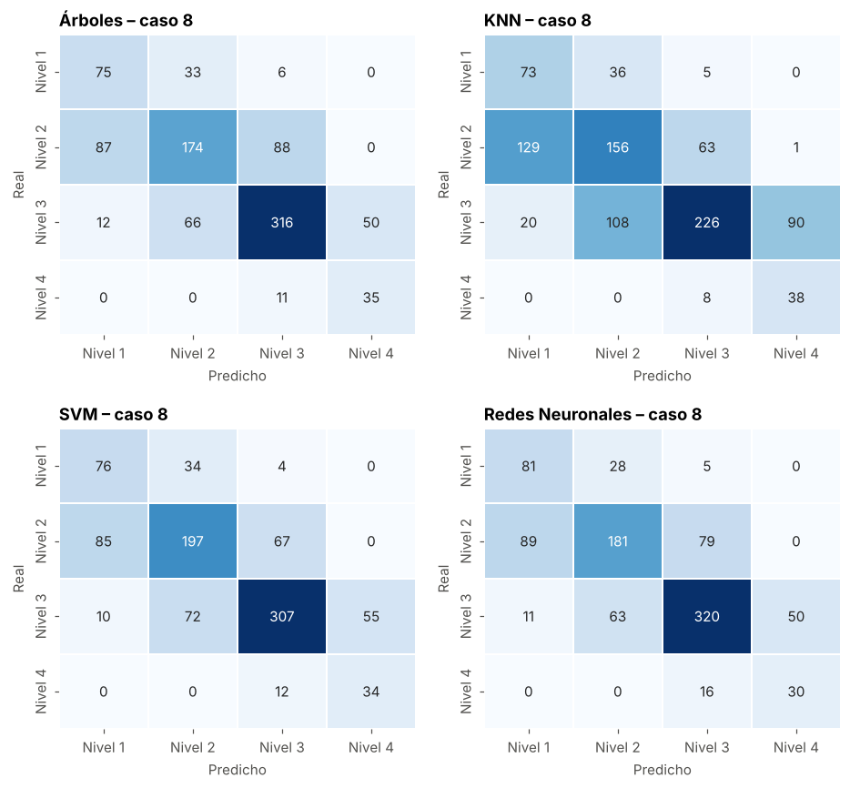{width=55%}

En un uso de alerta temprana, el error más costoso es un **falso negativo en Nivel 1**: un estudiante en riesgo que no recibe apoyo. Un falso positivo (dar refuerzo a un estudiante de Nivel 2) cuesta mucho menos. Por eso, además del F1 macro, priorizamos el **recall de Nivel 1**. En el caso 8, la red detecta más estudiantes de Nivel 1 (0.711), seguida de la SVM (0.667), el árbol (0.658) y KNN (0.640). La precisión de Nivel 1 queda entre 0.33 y 0.45, y sus falsas alarmas son casi siempre de Nivel 2. Además, solo entre 14 y 26 errores por modelo saltan más de un nivel: casi todos son entre niveles vecinos.

### 5.5 Curvas ROC y Precision-Recall del caso 8

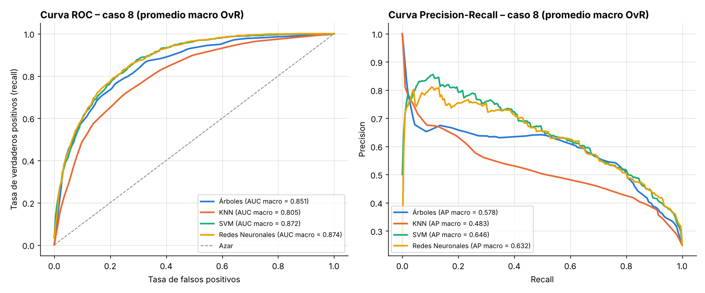{width=85%}

| Modelo | AUC-ROC macro | AP macro | AUC Nivel 4 | AP Nivel 4 |
|---|---|---|---|---|
| Red neuronal | 0.874 | 0.632 | 0.946 | 0.555 |
| SVM | 0.872 | 0.646 | 0.947 | 0.598 |
| Árbol | 0.851 | 0.578 | 0.908 | 0.410 |
| KNN | 0.805 | 0.483 | 0.909 | 0.326 |

La SVM y la red son prácticamente iguales en ROC y superan al árbol y a KNN en todo el rango. La diferencia se nota más en Precision-Recall, sobre todo en el Nivel 4. Le damos más peso a la curva PR porque la prueba está desbalanceada y la ROC resulta optimista con tantos negativos. Nivel 2 es la clase con menor AUC en los cuatro modelos (0.72–0.81). Para el caso 8 elegiríamos la SVM si se busca el mejor balance, o la red si lo prioritario es no dejar pasar estudiantes de Nivel 1.

# Módulo 2 – Aprendizaje no supervisado

## 6. Datos de la Figura 2 *(notebook: sección 8.0)*

Las versiones de la Figura 2 son los registros de entrenamiento de cada caso de la Figura 1, sin la etiqueta, con el mismo CC, escalado y outliers. Como no se puede balancear sobre una etiqueta eliminada, la correspondencia es por registros: las versiones desbalanceadas son los registros del submuestreo 70/10/10/10, y las balanceadas incluyen los sintéticos de SMOTENC (46–48 % del total). La etiqueta se conserva aparte, solo para la validación externa. Sin escalar, las 5 numéricas aportan el 97.1 % de la varianza (caso 1); con escalado, el 36.5 % (caso 5).

## 7. K-Means *(notebook: sección 8.1)*

Usamos `init="k-means++"`, `n_init=10` y `random_state=79`, con K de 2 a 10. El codo se lee con un criterio fijo: el punto más alejado de la recta entre los extremos de la curva.

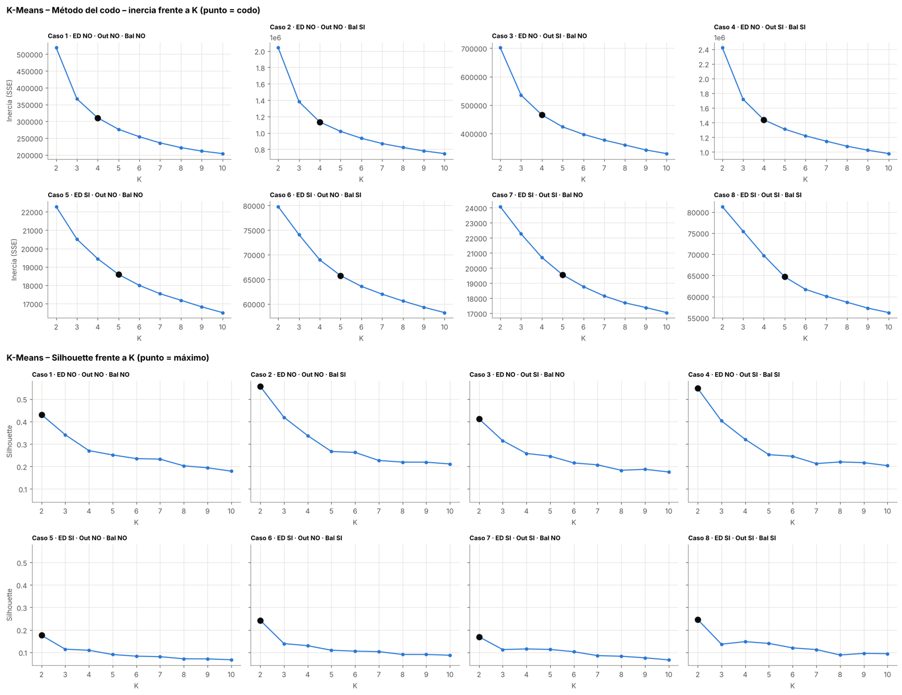{width=80%}

- **K óptimo = 2 en los 8 casos**, por silhouette máximo (0.41–0.56 sin escalar y 0.17–0.25 con escalado). El codo marca K = 4 sin escalar y K = 5 con escalado, pero ahí el silhouette baja a 0.26–0.34 y 0.09–0.14. No elegimos K = 4 por ser el número de niveles: eso sería usar la etiqueta.
- **Tamaño de los clusters:** 48–52 % en los casos desbalanceados y 59 % / 41 % en los balanceados. Los renumeramos para que C0 sea el de menor puntaje.
- **Escalado:** baja el silhouette entre 0.24 y 0.31, pero no cambia los grupos (89.5–94.7 % de registros quedan en el mismo cluster). Sin escalar el agrupamiento ocurre casi en una dimensión, la del puntaje; con escalado entran las dummies, que no tienen estructura de grupos. Un silhouette más alto sin escalar no significa mejores grupos.
- **Outliers:** el silhouette cambia entre −0.019 y +0.004. Los outliers se reparten en los dos clusters (4.0–6.0 % de cada uno) y no forman un grupo propio.

## 8. DBSCAN *(notebook: sección 8.2)*

MinPts = 2 × 65 características = **130** (regla del enunciado y de la diapositiva 6-03), y ε en el codo del gráfico de k-distancia con k = MinPts (ε entre 3.65 y 16.55).

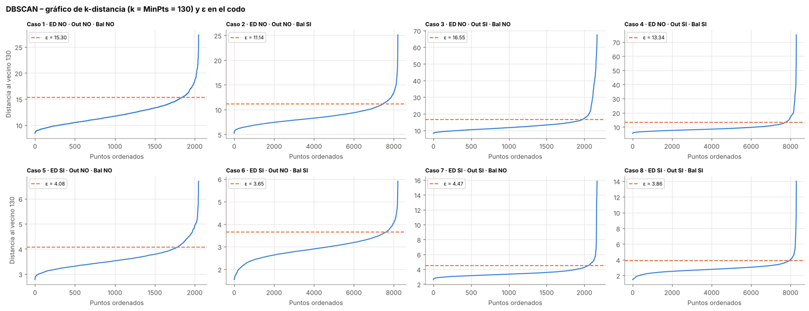{width=90%}

- **Resultado: un solo cluster en los 8 casos**, con 0.1–3.3 % de ruido, así que el silhouette no está definido. La segunda regla de la diapositiva (MinPts = 66) da lo mismo. La k-distancia sube de forma continua, sin escalones: no hay zonas de baja densidad que separen grupos.
- **Sensibilidad a ε:** al bajar ε desde el codo, el ruido crece antes de que aparezca un segundo cluster. En el caso 5 pasa del 15 % (80 % del codo) al 90 % (70 % del codo) sin separar nada. Con ε grande todo se fusiona y con ε pequeño casi todo es ruido.
- **Prueba complementaria.** Para que la gráfica de la Figura 3 tuviera valores, buscamos el ε más cercano al codo que separa al menos 2 clusters, bajando MinPts a 66 y a 10 cuando hizo falta (la diapositiva lo permite con mucho ruido). Aparecen grupos en todos los casos, pero con entre 7 % y 84 % de ruido, y en los casos 3 y 5 el segundo cluster tiene solo 6–7 registros.
- **Densidades variables.** En los casos balanceados, los clusters densos son en un 76–85 % registros sintéticos de SMOTENC, frente al 46–48 % del caso completo. SMOTENC crea zonas artificialmente densas, y un solo ε no sirve a la vez para esas zonas y para los datos reales.

## 9. Evaluación y comparación *(notebook: secciones 8.3 a 8.5)*

### 9.1 Figura 3

| # | Normalización | Outliers | Balanceo | K-Means inercia | K-Means silhouette | DBSCAN silhouette (regla) | DBSCAN silhouette (complementario) |
|---|---|---|---|---|---|---|---|
| 1 | CC(SI) y ED(NO) | NO | NO | 519 267.7 | 0.4308 | No definido (1 cluster) | 0.3848 |
| 2 | CC(SI) y ED(NO) | NO | SI | 2 042 146.0 | 0.5559 | No definido (1 cluster) | 0.4319 |
| 3 | CC(SI) y ED(NO) | SI | NO | 701 971.7 | 0.4118 | No definido (1 cluster) | 0.2197 |
| 4 | CC(SI) y ED(NO) | SI | SI | 2 421 380.6 | 0.5472 | No definido (1 cluster) | 0.4737 |
| 5 | CC(SI) y ED(SI) | NO | NO | 22 278.7 | 0.1760 | No definido (1 cluster) | 0.2122 |
| 6 | CC(SI) y ED(SI) | NO | SI | 79 754.1 | 0.2426 | No definido (1 cluster) | 0.3805 |
| 7 | CC(SI) y ED(SI) | SI | NO | 24 075.9 | 0.1694 | No definido (1 cluster) | 0.0249 |
| 8 | CC(SI) y ED(SI) | SI | SI | 81 264.8 | 0.2461 | No definido (1 cluster) | 0.4486 |

La inercia no es comparable entre casos (depende del número de registros y de la escala).

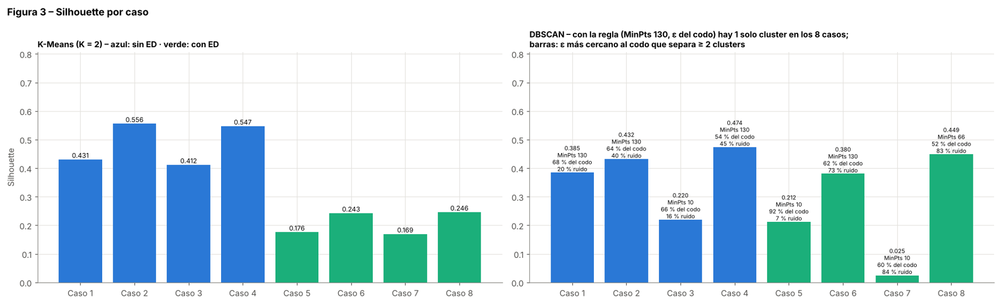{width=85%}

En K-Means, el escalado es el factor que más mueve el silhouette (0.486 sin escalar frente a 0.209 con escalado). El balanceo lo sube de 0.297 a 0.398, porque con 25 % de cada nivel hay más estudiantes en los extremos y la nube queda más alargada. Los outliers casi no influyen (0.351 frente a 0.344). Los valores de la prueba complementaria de DBSCAN no son comparables entre casos, porque cada uno necesitó una configuración y un ruido distintos.

### 9.2 Los 3 datos de prueba

Cubrimos las dos lecturas posibles del enunciado:

- **Registros reales** (los mismos 3 del módulo supervisado): K-Means asigna el de Nivel 1 a C0 y los de Nivel 3 y Nivel 4 a C1 en los 8 casos. DBSCAN con la regla los asigna a su único cluster, excepto al de Nivel 1 en los casos 2, 5 y 6, que queda como ruido por ser un punto extremo. Para asignar en DBSCAN, que no tiene `predict`, usamos el *core sample* más cercano a menos de ε.
- **Estudiantes hipotéticos**, construidos a mano como el "nuevo vino" del notebook 6-03:

| Perfil | Puntajes | Contexto | K-Means (8 casos) |
|---|---|---|---|
| Bajo | 33 a 38 | 19 años, estrato 1, padres con primaria, colegio rural oficial, sin computador ni internet | C0 |
| Medio | 50 a 55 | 17 años, estrato 2, padres bachilleres, colegio urbano oficial | C0 |
| Alto | 72 a 85 | 16 años, estrato 5, madre profesional y padre con posgrado, colegio bilingüe no oficial | C1 |

El perfil medio queda en C0 porque la frontera entre clusters está cerca de los 55 puntos.

### 9.3 Comparación entre K-Means y DBSCAN

| Aspecto | K-Means | DBSCAN |
|---|---|---|
| Forma de los clusters | Esféricos; aquí corta la nube en dos mitades a lo largo de PC1 | Arbitraria; con ε del codo, toda la nube es un cluster |
| Número de clusters | Hay que definir K y siempre entrega K grupos, aunque no haya separación natural | No requiere K; encontrar uno solo indica que no hay estructura de densidad |
| Ruido y outliers | Asigna todos los registros; con K = 2 su efecto es mínimo | Los separa como ruido: 0.1–3.3 % con la regla, hasta 84 % al bajar ε |
| Densidades variables | No depende de la densidad | Es su punto débil: en los casos balanceados solo ve los núcleos de sintéticos |
| Sensibilidad | Escalado e inicialización (controlada con k-means++ y n_init = 10) | ε y MinPts: en el caso 7, del 70 % al 60 % del codo el ruido pasa del 16 % al 89 % |

## 10. Visualización e interpretación de los clusters *(notebook: secciones 8.6 y 8.7)*

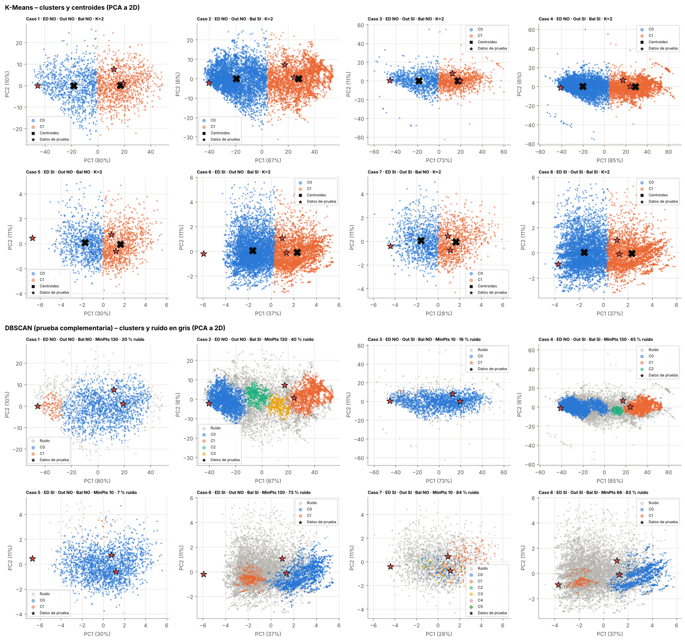{width=80%}

Sin escalar, PC1 explica el 73–87 % de la varianza (el puntaje); con escalado, el 28–37 %. En ninguna proyección hay un espacio vacío entre los clusters de K-Means: es una nube continua cortada por la mitad.

| Cluster | Lectura crítica (media) | Estrato | Educación madre (código) | Edad | % Nivel 1 | % Nivel 4 |
|---|---|---|---|---|---|---|
| C0 – desempeño bajo | 45–49 | 1.7–2.0 | 3.3–3.9 | 17.1–18.0 | 19–42 % | 0.0–0.4 % |
| C1 – desempeño alto | 64–67 | 2.4–2.6 | 5.3–6.0 | 16.5–16.9 | 0.1–0.4 % | 19–61 % |

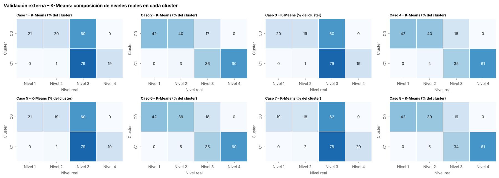{width=90%}

**Validación externa.** Los clusters separan bien los extremos (C0 casi no tiene Nivel 4 y C1 casi no tiene Nivel 1), pero no los niveles intermedios. En los casos desbalanceados, Nivel 3 es el 60–62 % de C0 y el 78–79 % de C1. En los balanceados, C0 mezcla Nivel 1 y 2 y C1 mezcla Nivel 3 y 4.

**Interpretación en el dominio.** Los puntajes de las cinco áreas se mueven juntos y acompañan al estrato y a la educación de los padres. Sin la etiqueta, lo que aparece es un eje de "desempeño general", no cuatro niveles. Es el mismo patrón de los modelos supervisados, que aciertan los extremos y confunden niveles vecinos. Los clusters de la prueba complementaria de DBSCAN son muy puros en los casos balanceados (caso 8: 89 % de Nivel 4 en C0), pero como son sobre todo registros sintéticos y dejan el 83 % como ruido, no los interpretamos como grupos reales.

# Conclusiones

1. **El balanceo fue el preprocesamiento más influyente.** Mejoró el F1 macro de las cuatro técnicas y fue la diferencia entre que la red aprendiera las cuatro clases o solo la mayoritaria. Con clases desbalanceadas, el accuracy no sirve para comparar modelos.
2. **El escalado depende del modelo.** No cambia los árboles, es necesario para la red, la SVM se adapta sola con buenos hiperparámetros, y en KNN empeora el resultado porque da peso a variables que no aportan.
3. **Los outliers, al 5 %, no tuvieron un efecto apreciable** en ninguno de los seis algoritmos.
4. **La SVM fue la técnica supervisada más estable** (F1 de 0.605). La red la iguala en el caso 8 y es la que más estudiantes de Nivel 1 detecta. El árbol queda muy cerca y es el único explicable con reglas simples ("ciencias ≤ 40 y lectura ≤ 46"). KNN fue el más débil.
5. **El aprendizaje no supervisado explica el techo de los clasificadores** (F1 cercano a 0.6). K-Means solo encuentra dos perfiles, bajo y alto, asociados al estrato y a la educación de los padres, y DBSCAN no encuentra separaciones de densidad. El desempeño es un continuo, y los niveles del ICFES son cortes sobre él: por eso los errores son entre niveles vecinos y Nivel 2 es el más difícil.
6. **SMOTENC cambia la geometría de los datos.** Crea zonas densas artificiales que DBSCAN detecta como clusters y que inflan la validación cruzada de KNN. Hay que tenerlo en cuenta al leer métricas calculadas sobre datos balanceados.

# Referencias

- ICFES. *Resultados únicos Saber 11*, aplicaciones 2022-1 y 2022-2. Datos abiertos.
- Guzmán Luna, J. A. Diapositivas y notebooks del curso Introducción a la Inteligencia Artificial (5-01 a 7-06). Universidad Nacional de Colombia, 2026.
- Documentación de scikit-learn, imbalanced-learn (SMOTENC) y TensorFlow/Keras.
